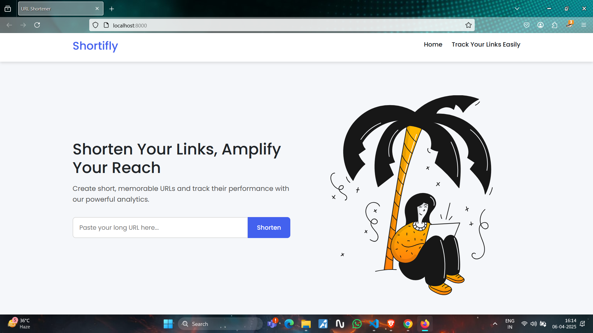
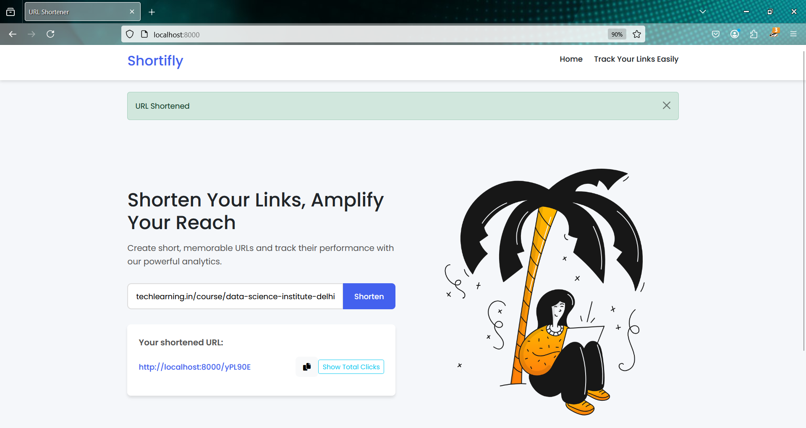
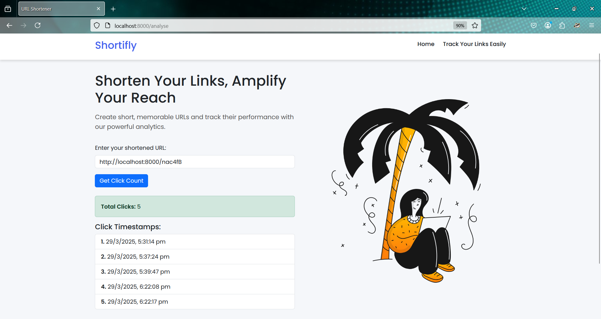
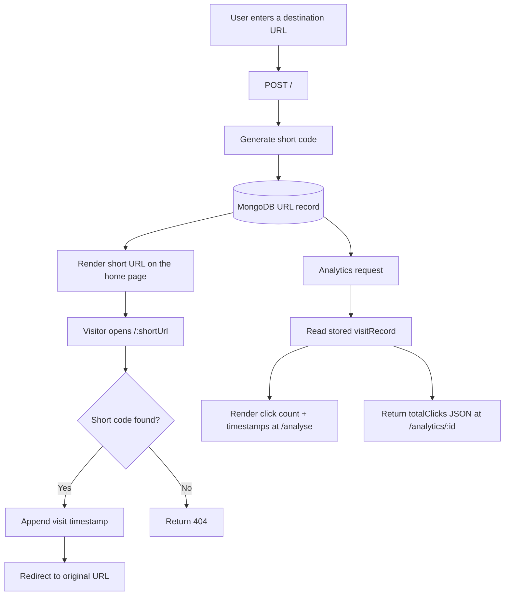
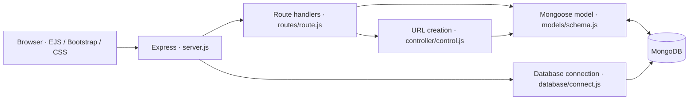

<div align="center">

# 🔗 Shortifly

### Short links. Clear insights. Simple sharing.

**A full-stack URL shortener and click-tracking web application built with Node.js, Express, MongoDB, and EJS.**

[](https://nodejs.org/)
[](https://expressjs.com/)
[](https://www.mongodb.com/)
[](https://ejs.co/)

[](https://github.com/Abhii26/Shortifly/stargazers)
[](https://github.com/Abhii26/Shortifly/commits)
[](https://github.com/Abhii26/Shortifly/issues)

[**Explore the source code**](https://github.com/Abhii26/Shortifly) · [**Getting started**](#-getting-started) · [**Application workflow**](#-application-workflow) · [**Routes**](#-routes-and-endpoints)

</div>

---

## 📌 Overview

**Shortifly** turns long destination URLs into compact, shareable links and records when those links are visited. Users can generate a short link, follow it to the original website, and inspect click totals and visit timestamps in a dedicated analytics view.

The project is an **Express server-rendered application**, with **EJS** views for the interface and **MongoDB/Mongoose** for persistent URL mappings and visit history. It demonstrates backend routing, database modeling, HTTP redirects, request handling, and basic web analytics.

> **Project status:** Working source-code implementation for local development. The provided project snapshot does not establish a public live deployment. Short URLs currently use the hard-coded base `http://localhost:8000` and must be adjusted before production hosting.

## ✨ Highlights

| Capability | How it works |
| --- | --- |
| 🔗 **Short-link generation** | Accepts a destination URL and generates a unique short identifier with `short-unique-id`. |
| ↪️ **Automatic redirects** | Looks up a short code and redirects visitors to its stored destination. |
| 📈 **Click tracking** | Appends a numeric timestamp to the URL's `visitRecord` array whenever a matching short link is opened. |
| 🕒 **Visit history** | Displays total visits and individual visit times on the analytics page. |
| ⚡ **Quick count lookup** | Provides a `GET /analytics/:id` endpoint returning the total click count as JSON. |
| 🗃️ **Persistent storage** | Uses a Mongoose model to store short codes, destination URLs, and visit records in MongoDB. |
| 🖥️ **Server-rendered interface** | EJS views, Bootstrap, and custom CSS provide the shortener and analytics pages. |

## 📸 Application preview

Screenshots are included in this repository under [`assets/`](assets/).

### 1. Home — shorten a URL

Enter a destination URL in the home-page form.



### 2. Generated short link

After submitting, the page displays a newly generated short link, along with controls for copying and checking clicks.



### 3. Analytics — total visits and timestamps

Enter a shortened URL on the analytics page to retrieve its total number of recorded visits and the corresponding visit timestamps.



> **UI note:** The current source displays a copy button, but its event handler is not wired up. A working copy-to-clipboard interaction is listed under [Roadmap](#-roadmap).

## 🔄 Application workflow

The following diagram describes the actual request and data flow implemented in the project.



### Step by step

1. **Create:** A user submits a long URL through the `POST /` form. `controller/control.js` generates a short identifier and creates a MongoDB document.
2. **Return:** The app renders a short URL such as `http://localhost:8000/aB12cD` using that identifier.
3. **Visit:** When someone opens the link, `GET /:shortUrl` looks up the record, appends `Date.now()` to its visit history, and redirects the visitor to `redirectUrl`.
4. **Analyse:** `POST /analyse` accepts a short URL, extracts its final path segment, finds the corresponding record, and renders the total visits and formatted timestamps.
5. **Quick lookup:** `GET /analytics/:id` returns a compact JSON response containing `totalClicks`.

A visit is counted when the **short redirect URL is requested**, not simply when it is created or copied.

## 🏗️ Architecture



**Separation of responsibilities**

- **Presentation:** `views/index.ejs`, `views/analyse.ejs`, reusable layouts, and `public/style.css`.
- **Routing:** `routes/route.js` handles home, link creation, redirects, analytics forms, and analytics JSON.
- **Controller:** `controller/control.js` contains the short-code generation logic.
- **Data:** `models/schema.js` defines the URL record; `database/connect.js` establishes the MongoDB connection.
- **Application startup:** `server.js` configures Express middleware, static files, view rendering, routing, and the local port.

## 🧰 Technology stack

| Layer | Tools |
| --- | --- |
| Runtime | Node.js |
| Web server | Express.js |
| Database | MongoDB |
| Database ODM | Mongoose |
| View templates | EJS |
| UI | HTML, custom CSS, Bootstrap 5, Font Awesome |
| Unique short codes | `short-unique-id` |
| Request body parsing | `body-parser`, Express JSON middleware |
| Configuration | `dotenv` |
| Development server | `nodemon` |

## 🧾 Data model

A URL mapping is represented by the Mongoose model in `models/schema.js`:

```js
{
  shortUrl: String,            // Unique short code
  redirectUrl: String,         // Original destination
  visitRecord: [
    { timestamp: Number }      // Visit time (Unix milliseconds)
  ]
}
```

Example **illustrative** record:

```json
{
  "shortUrl": "aB12cD",
  "redirectUrl": "https://example.com/articles/123",
  "visitRecord": [
    { "timestamp": 1761600000000 },
    { "timestamp": 1761600360000 }
  ]
}
```

The analytics views derive `totalClicks` from `visitRecord.length` rather than storing a separate click counter.

## 🌐 Routes and endpoints

| Method | Path | Purpose | Response |
| --- | --- | --- | --- |
| `GET` | `/` | Show the shortener page | HTML |
| `POST` | `/` | Generate and save a short link | HTML with result |
| `GET` | `/:shortUrl` | Record a visit and redirect | HTTP redirect; `404` if unknown |
| `GET` | `/analyse` | Show the analytics lookup form | HTML |
| `POST` | `/analyse` | Look up clicks and visit timestamps | HTML with results or error |
| `GET` | `/analytics/:id` | Fetch a link's click count | JSON |

Example JSON from `GET /analytics/aB12cD`:

```json
{
  "totalClicks": 2
}
```

> The app currently serves **HTML forms** for link creation and detailed analytics. It does not expose a separate JSON API for creating links.

## 🚀 Getting started

### Prerequisites

- **Node.js and npm** installed (a current Node.js LTS release is recommended).
- **MongoDB**, either running locally or accessible through a MongoDB connection string.
- **Git** to clone the repository.

### 1. Clone the repository

```bash
git clone https://github.com/Abhii26/Shortifly.git
cd Shortifly
```

### 2. Install dependencies

```bash
npm ci
```

`npm install` also works if you need to regenerate the lockfile.

### 3. Configure MongoDB

Create a `.env` file in the repository root:

```env
# Local MongoDB example
DB_URI=mongodb://127.0.0.1:27017/shortifly
```

For MongoDB Atlas, replace the example with your own connection string. The variable name must be **`DB_URI`**, because `database/connect.js` reads `process.env.DB_URI`.

> Never commit `.env` or database credentials. `.env` is already covered by the project's `.gitignore`.

### 4. Start the server

```bash
npm start
```

This runs `nodemon server.js`, as configured in `package.json`. To launch without nodemon, use:

```bash
node server.js
```

### 5. Open Shortifly

Visit **http://localhost:8000** in a browser.

| Action | Local URL |
| --- | --- |
| Create a short link | `http://localhost:8000/` |
| Look up analytics | `http://localhost:8000/analyse` |

### 6. Try the complete flow

1. Paste a URL such as `https://example.com` into the home-page field.
2. Select **Shorten** and open the generated short link.
3. Return to Shortifly and open **Track Your Links Easily**.
4. Paste the generated short URL, then select **Get Click Count**.
5. Review the recorded click count and timestamps.

## 📁 Project structure

```text
Shortifly/
├── assets/
│   ├── homepage.png              # Home-page screenshot
│   ├── tracklinks.png            # Generated-link screenshot
│   └── totallinks.png            # Analytics screenshot
├── controller/
│   └── control.js                # Generate and store short links
├── database/
│   └── connect.js                # MongoDB connection via DB_URI
├── models/
│   └── schema.js                 # URL and visit-history schema
├── public/
│   └── style.css                 # Custom styling
├── routes/
│   └── route.js                  # Express route handlers
├── views/
│   ├── layout/
│   │   ├── header.ejs            # Shared page header/navigation
│   │   └── footer.ejs            # Shared footer
│   ├── index.ejs                 # Short-link creation page
│   └── analyse.ejs               # Analytics lookup page
├── .gitignore                    # Ignore dependencies and secrets
├── package.json                  # Dependencies and npm scripts
├── package-lock.json             # Locked dependency tree
├── server.js                     # Express app entry point
└── README.md                     # Project documentation
```

**Note:** `.env` is created locally during setup and is intentionally not tracked in Git.

## ☁️ Deployment considerations

Shortifly requires a **running Node.js/Express server and a MongoDB database**. It is not a static frontend that can be deployed by uploading HTML files alone.

Before publishing it on a Node-compatible hosting platform:

1. Provision a MongoDB database and configure its **`DB_URI`** securely.
2. Change the hard-coded `http://localhost:8000` short-link base in `controller/control.js` to your public application URL (ideally through a configuration variable).
3. Update `server.js` to respect the hosting provider's `process.env.PORT`, rather than always listening on port `8000`.
4. Review URL validation, redirect safety, error handling, and rate limiting before accepting public traffic.
5. Test link creation, redirects, and analytics against the deployed domain.

These are **deployment changes to make**, not features already implemented in the uploaded snapshot.

## 🛡️ Limitations and security notes

This project is a learning/portfolio implementation, not a hardened public URL-shortening service.

- Submitted destination URLs are **not validated or restricted by the server** before storage.
- Short links and analytics are **publicly accessible**; there is no authentication, user ownership, or access control.
- There is no rate limiting, abuse prevention, expiration policy, or automated cleanup of visit histories.
- Generated links currently point to **`localhost:8000`**, which works only on the developer's machine unless reconfigured.
- The copy button is visible, but its click action requires wiring up.
- The supplied `npm test` script is a placeholder; automated tests have not been implemented.

## 🗺️ Roadmap

- [ ] Wire up and test the **Copy URL** button
- [ ] Add robust URL validation and safe redirect rules
- [ ] Support environment-based public host URLs and server port
- [ ] Add automated tests for link creation, redirect handling, and analytics
- [ ] Add custom aliases, link expiration, and deletion controls
- [ ] Introduce authentication and personal link dashboards
- [ ] Visualize daily and weekly clicks with charts
- [ ] Add API rate limiting, monitoring, and abuse protection
- [ ] Prepare and validate a production deployment

## 🤝 Contributing

Contributions, bug reports, and suggestions are welcome. Open an [issue](https://github.com/Abhii26/Shortifly/issues) or fork the repository and submit a pull request.

For a code contribution:

```bash
git checkout -b feature/your-feature
# Make your changes and verify locally
git add .
git commit -m "feat: describe your change"
git push origin feature/your-feature
```

Then open a pull request against the `main` branch.

## 📄 License status

The uploaded project includes **`"license": "ISC"`** in `package.json`, but did **not** contain a standalone `LICENSE` file. Confirm the intended license and the rights to all included assets before adding a license badge or claiming MIT licensing. The prior README's MIT statement was not supported by the included project files.

## 👨‍💻 Author

**Abhishek Tiwari** · [GitHub @Abhii26](https://github.com/Abhii26)

---

<div align="center">

**Shorten smarter. Track better. Share faster.**

If this project is useful, consider starring the [repository](https://github.com/Abhii26/Shortifly).

</div>
