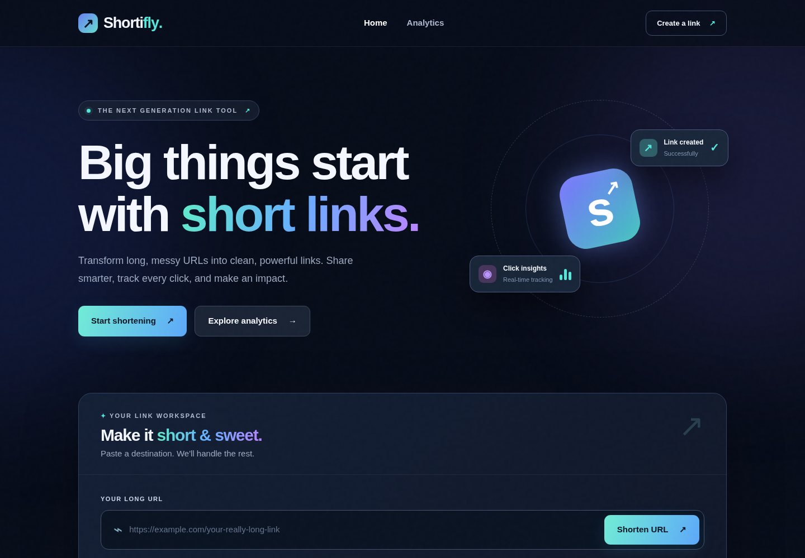
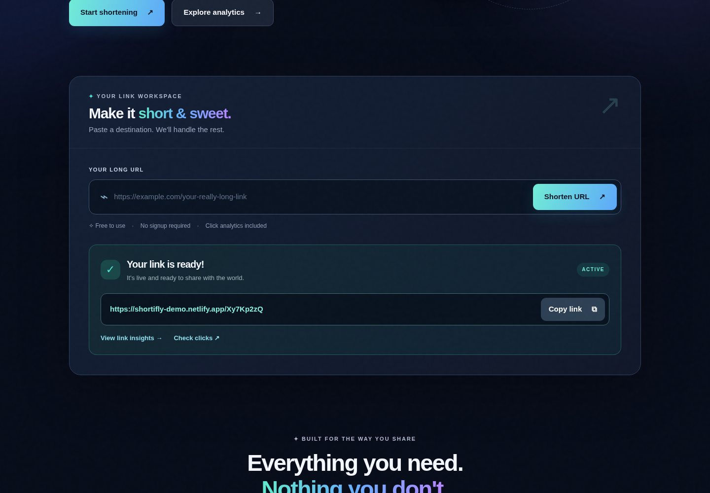
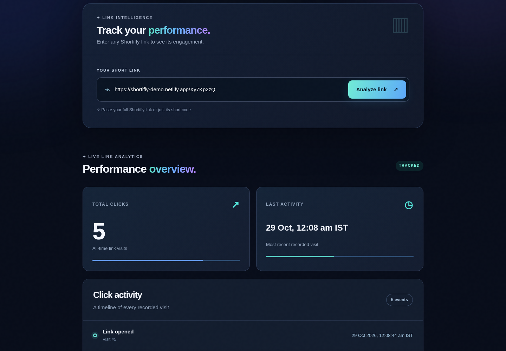

<div align="center">

# ↗ Shortifly Studio

**Short links. Big impact.**

A modern, animated URL-shortening web app built with **Node.js, Express, EJS and MongoDB** — with shareable links, click analytics, and a responsive interface.

[**🚀 Try the live demo**](https://shortifly-demo.netlify.app/) · [**📊 Explore analytics**](https://shortifly-demo.netlify.app/analyse) · [**🐛 Report an issue**](https://github.com/Abhii26/Shortifly/issues)

   

</div>

---

## ✨ The experience

### Landing page

A dark, gradient-led interface with responsive layout, animated floating link illustrations, and an easy-to-use shortening workspace.



### Link created

Enter any valid HTTP or HTTPS URL. Shortifly generates a short link you can copy, open, and analyze.



### Click analytics

Paste a shortened link or its code to see total visits, the latest activity, and a visit timeline. Timestamps are stored as Unix milliseconds and displayed in the visitor's local timezone (with an India Standard Time fallback in server-rendered HTML).



> **Screenshot note:** These are captures rendered locally from this repository's EJS templates. The sample short code and click counts shown in the result/analytics images are *illustrative*, not claims about live production traffic. The screenshot assets contain no real credentials or user analytics.

## 🚀 Features

- **Instant shortening:** generate an 8-character short code for HTTP/HTTPS URLs.
- **Working redirects:** visiting a short link sends you to its original destination.
- **Click tracking:** record a timestamp when someone visits a short URL.
- **Link analytics:** total click count, last activity, and per-visit timeline.
- **Timezone-aware display:** visitor-local timestamps in the browser, including IST in India.
- **One-click copy:** copy generated short URLs from the result panel.
- **Responsive motion UI:** animated gradients, floating elements, hover effects, and reduced-motion support.
- **No visitor login:** users can shorten links and inspect their link's counts without signing in.

## 🧰 Tech stack

| Layer | Technologies |
|:--|:--|
| Frontend | EJS, HTML, CSS, vanilla JavaScript |
| Backend | Node.js, Express |
| Database | MongoDB Atlas (Mongoose ODM) |
| Short IDs | `short-unique-id` |
| Hosting | Netlify Functions (`serverless-http`) + static assets |
| Local development | Node.js / npm, optional `nodemon` |

## 🏗️ How it works

```text
Visitor → Shortifly EJS form → Express route → MongoDB
                                     │
                                     └─ Creates short code and returns link

Visitor opens /:shortUrl → Express route → Records click → Redirects to destination

Visitor opens /analyse → Express route → Queries visits → Renders analytics EJS
```

The project works as a conventional Express server locally and as an Express application wrapped by a Netlify Function in production.

## 💻 Run locally

**Prerequisites:** Node.js 18+ and npm; a MongoDB connection URI from a local MongoDB instance or MongoDB Atlas.

```bash
git clone https://github.com/Abhii26/Shortifly.git
cd Shortifly
npm install
```

Create a private `.env` file in the project root:

```dotenv
DB_URI=mongodb://127.0.0.1:27017/urlshortner
PORT=8000
```

If using Atlas, replace `DB_URI` with your own connection string (usually `mongodb+srv://.../urlshortner`), and ensure Atlas network access and the database user are configured. **Never commit a real URI, password or `.env` file.**

Start the app:

```bash
npm start
```

Visit **http://localhost:8000** to shorten a link or **http://localhost:8000/analyse** to inspect click analytics.

## ☁️ Deploy on Netlify

The `netlify.toml` file configures the static asset directory, serverless Express handler, EJS dependency, EJS view inclusion, and rewrites.

1. Create a Netlify project or link this folder to an existing one.
2. Add `DB_URI` in **Project configuration → Environment variables**; use a reachable MongoDB Atlas database, **not** `localhost`.
3. For optional custom URL generation, set `URL_BASE` to your public site URL.
4. Deploy using the Netlify CLI:

```bash
npm install
npx netlify-cli login
npx netlify-cli link
npx netlify-cli deploy --build --prod
```

The public demo for this project is **https://shortifly-demo.netlify.app/**.

More information: [Netlify deployment guide](DEPLOY-NETLIFY.md).

> **Note:** Changing Netlify environment variables requires a new deployment. A manual CLI deployment is independent of the GitHub repository unless you later enable Git-based continuous deployment.

## 📁 Project structure

```text
Shortifly/
├── controller/          # Input validation, short-code creation
├── database/            # Mongoose database connection
├── models/              # URL and visit record model
├── routes/              # Home, analytics, short URL redirect routes
├── views/               # EJS pages and shared layout
├── public/              # Animated UI CSS and browser JavaScript
├── netlify/functions/   # Express-to-Netlify serverless handler
├── docs/screenshots/    # Up-to-date UI screenshots
├── server.js            # Local Express server
├── netlify.toml         # Netlify deployment configuration
├── .env.example         # Safe example configuration
└── package.json
```

## 🔐 Security and privacy

- Real database credentials belong in `.env` locally or Netlify environment variables in production.
- `.gitignore` excludes `.env` and local build artifacts.
- The analytics feature is intentionally unauthenticated in this demo; avoid shortening sensitive/private destinations.
- For a larger public rollout, add rate limiting, abuse protection, and stronger controls around public analytics.

## 📌 Future improvements

Custom aliases · QR codes · authenticated dashboards · expiration dates · geographic insights · abuse prevention.

---

<div align="center">

Built with Node.js, Express, EJS & MongoDB · **[Live Shortifly demo](https://shortifly-demo.netlify.app/)**

</div>
