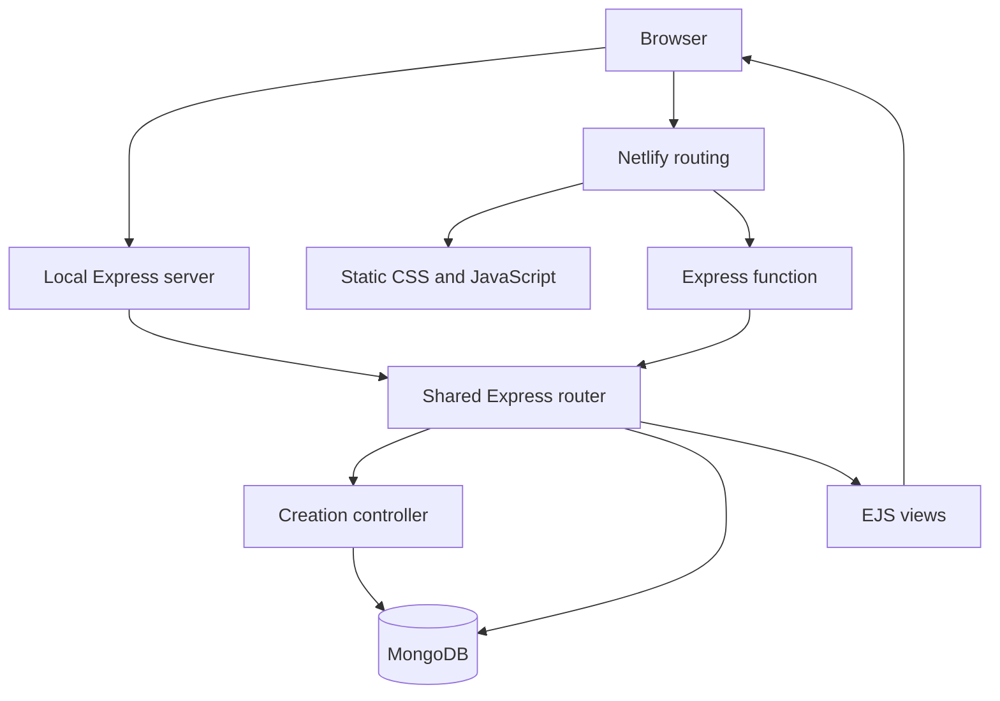
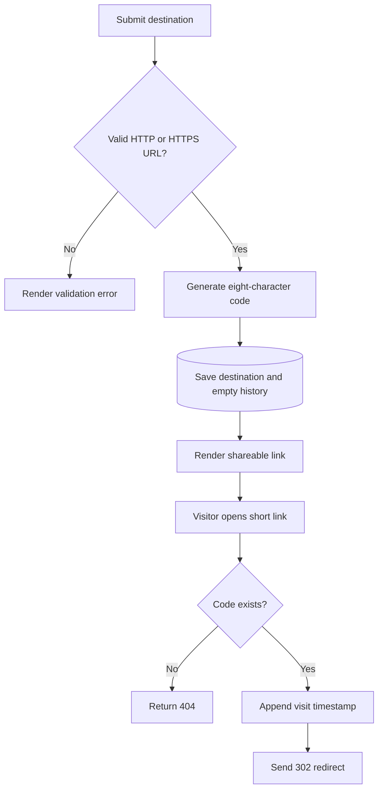

<div align="center">


# Shortifly Studio

**A better link is just the beginning.**

Turn long URLs into shareable links, then understand when they get opened.<br />
Built with **Node.js · Express · EJS · MongoDB**.

[**Launch demo ↗**](https://shortifly-demo.netlify.app/) · [**Explore analytics**](https://shortifly-demo.netlify.app/analyse) · [**Report an issue**](https://github.com/Abhii26/Shortifly/issues)

**8-character codes · HTTP/HTTPS destinations · 302 redirects · Timestamped visits**

[Experience](#the-experience) · [Quickstart](#quickstart) · [Architecture](#architecture) · [Routes](#route-reference) · [Deployment](#deployment) · [Roadmap](#roadmap)

[View the static banner](docs/readme/hero.png)

</div>

---

## The experience

**Paste a destination. Create a link. Share it. Read its story.**


| Create | Share | Understand |
| --- | --- | --- |
| Submit a valid HTTP or HTTPS destination and receive an eight-character code. | Copy the generated URL or open it directly. Visitors are redirected to the saved destination. | Look up a short URL or code to see total visits, last activity, and a chronological activity list. |

<details>
<summary><strong>See a generated link</strong></summary>


</details>

<details>
<summary><strong>See click analytics</strong></summary>


</details>

> Screenshots were rendered locally from the supplied EJS templates. Short codes and counts are illustrative. They do not represent production traffic. The animated banner is original decorative artwork.

## Features

- **Simple creation:** HTTP/HTTPS validation and randomly generated eight-character codes.
- **Persistent destinations:** MongoDB stores each code, destination, and visit history.
- **Tracked redirects:** a visit timestamp is appended before a successful `302` redirect.
- **Link insights:** totals, latest activity, and a reverse-chronological visit list.
- **Copy and share:** clipboard action, direct opening, and a shortcut to analytics.
- **Responsive interface:** gradient styling, floating illustrations, focus indicators, and CSS reduced-motion rules.
- **No signup:** creation and analytics are publicly accessible.
- **Two execution modes:** conventional Express locally; Netlify Functions in deployment.

Visit timestamps use Unix milliseconds. EJS provides an India Standard Time fallback. Browser-local formatting has a known option conflict in this snapshot; see the [project review](docs/PROJECT-REVIEW.md).

## Quickstart

Use a [supported Node.js LTS release](https://nodejs.org/en/about/previous-releases), npm, and a running local MongoDB instance or MongoDB Atlas database. Node.js 22 or 24 LTS are suitable starting points; this snapshot has no declared engine or runtime test matrix.

```bash
git clone https://github.com/Abhii26/Shortifly.git
cd Shortifly
npm install
```

Alternatively, extract the project archive and open the directory containing `package.json`.

Create `.env` in that directory:

```dotenv
DB_URI=mongodb://127.0.0.1:27017/urlshortner
PORT=8000
# Optional: override the origin used in generated links
# URL_BASE=https://your-domain.example
```

For Atlas, substitute your own connection URI and configure database credentials and network access.

```bash
npm start
```

Open [localhost:8000](http://localhost:8000) or [localhost:8000/analyse](http://localhost:8000/analyse). For automatic restarts, use `npm run dev`.

> Use `npm install` for this snapshot: `serverless-http` is declared in `package.json` but missing from the supplied lockfile. Regenerate and commit the lockfile before adopting `npm ci`.

### Configuration

| Variable | Required | Purpose |
| --- | --- | --- |
| `DB_URI` | Yes | MongoDB connection URI, including the desired database. |
| `PORT` | No | Local HTTP port; defaults to `8000`. |
| `URL_BASE` | No | Public origin used to build short links. Otherwise inferred from request headers. Use your own deployed origin. |

Never commit `.env` or real database credentials. `.env.example` contains placeholders only.

## Architecture

The two entry points share the same router, controller, model, and templates.



### Request workflow



Analytics requests query the saved document and render its visit history. The JSON endpoint returns only `totalClicks`. Analytics refresh on request; no streaming or automatic polling is implemented.

### Data model

| Field | Stored value |
| --- | --- |
| `shortUrl` | Required short code with a unique index declaration. |
| `redirectUrl` | Required normalized destination URL. |
| `visitRecord` | Array of subdocuments containing numeric `timestamp` values. |

Repeat visits count separately. Counts represent recorded redirect requests, including possible bots or previews; they are not unique-person counts.

## Route reference

| Method | Route | Input | Result |
| --- | --- | --- | --- |
| `GET` | `/` | — | Shortening page. |
| `POST` | `/` | Form field `url` | Creates a link and renders HTML; invalid destinations return `400`. |
| `GET` | `/analyse` | Optional query `url` | Analytics form, optionally prefilled. |
| `POST` | `/analyse` | Form field `shortUrlInput` | Renders totals and visit history for a URL or code. |
| `GET` | `/analytics/:id` | Short code in path | JSON count; `404` if absent. |
| `GET` | `/:shortUrl` | Short code in path | Records a visit and redirects; `404` if absent. |

Example count lookup against a link you created locally:

```bash
curl http://localhost:8000/analytics/YOUR_CODE
```

```json
{ "totalClicks": 5 }
```

The response above is illustrative. Creation and the analytics form return HTML, rather than a JSON creation API.

## Technology

| Layer | Choice | Responsibility |
| --- | --- | --- |
| Runtime and server | Node.js, Express 4 | Routing, validation responses, redirects. |
| Rendering | EJS 3 | Server-rendered pages and shared layouts. |
| Browser | HTML, CSS, vanilla JavaScript | Responsive styling, clipboard actions, count lookup. |
| Persistence | MongoDB, Mongoose 8 | Destinations and embedded visit records. |
| Identifiers | `short-unique-id` | Random eight-character codes. |
| Deployment | Netlify Functions, `serverless-http` | Express adapter and static asset hosting. |
| Development | dotenv, nodemon | Local configuration and automatic restarts. |

## Deployment

The supplied `netlify.toml` publishes `public/`, bundles `netlify/functions/`, includes EJS views, and rewrites application requests to the function.

1. Create or link a Netlify project.
2. Set `DB_URI` in the project's environment settings and make it available to Functions. Use a reachable database such as Atlas.
3. Optionally set `URL_BASE` to your public HTTPS origin.
4. From the project directory, run:

```bash
npm install
npx netlify-cli login
npx netlify-cli link
npx netlify-cli deploy --build --prod
```

Redeploy after changing function environment variables. Git-based deployment must be configured separately from manual CLI deployment.

[Deployment guide](DEPLOY-NETLIFY.md) · [Preserve the original version when updating GitHub](GITHUB-UPDATE-GUIDE.md)

## Source map

| Location | Responsibility |
| --- | --- |
| [`controller/control.js`](controller/control.js) | Validate destinations and generate links. |
| [`database/connect.js`](database/connect.js) | Establish or reuse a Mongoose connection. |
| [`models/schema.js`](models/schema.js) | Define destinations and visit history. |
| [`routes/route.js`](routes/route.js) | Page routes, analytics, and redirects. |
| [`views/`](views/) | EJS pages and shared header/footer. |
| [`public/`](public/) | Styles and browser behavior. |
| [`server.js`](server.js) | Start the local server after database connection. |
| [`netlify/functions/app.js`](netlify/functions/app.js) | Wrap Express as a serverless handler. |
| [`docs/`](docs/) | Screenshots, README artwork, and project review. |

## Verification and troubleshooting

There is no automated test suite in this snapshot; `npm test` is a failing placeholder. To verify a configured local instance:

1. Submit a valid destination and copy the generated link.
2. Open it and confirm the intended destination loads.
3. Look up its code in `/analyse` and confirm the count increases.
4. Query `/analytics/:id` and compare its total.
5. Submit an invalid destination and try an unknown code.

| Symptom | Check |
| --- | --- |
| Local server exits before listening | `DB_URI`, database availability, credentials, and Atlas network access. |
| Netlify returns `503` | Function environment configuration and database reachability. |
| Generated origin is wrong | Set `URL_BASE` to the deployed site's origin. |
| Browser times remain in IST | Known formatter conflict; consult the review below. |
| Installation fails with `npm ci` | Reconcile the supplied dependency lockfile with `npm install`. |

[Read the complete source review and recommended fixes →](docs/PROJECT-REVIEW.md)

## Privacy and deployment considerations

Analytics are public to anyone who has a code. Avoid sensitive destinations. The application currently has no authentication, rate limiting, destination abuse screening, or expiration controls. A broader public rollout should add these controls and review forwarded-header trust.

Visit history grows inside each link document. A separate indexed event collection and aggregated counts would support larger workloads. Database write failure currently prevents redirection because recording the visit happens first.

## Roadmap

The items below are proposed work, without committed dates.

- [x] HTTP/HTTPS shortening and persistent destinations.
- [x] Tracked redirects and analytics pages.
- [x] Responsive animated interface and serverless deployment adapter.
- [ ] **Reliability:** repair browser timestamp formatting, synchronize the lockfile, correct schema timestamp configuration, and add code-collision retries.
- [ ] **Quality:** route/integration tests, continuous integration, and a documented runtime matrix.
- [ ] **Public rollout:** rate limits, abuse reporting, destination screening, and trusted origin handling.
- [ ] **Link controls:** custom aliases, expiration, and QR codes.
- [ ] **Accounts:** authenticated dashboards and private analytics.
- [ ] **Analytics at scale:** separate visit events, pagination, aggregation, and privacy-aware insights.

## Contributing

Open an issue describing the problem or proposed improvement, then submit a focused pull request. Include reproduction steps, verification notes, and screenshots for interface changes. Keep credentials and local build artifacts out of commits.

The package metadata declares `ISC`; this snapshot does not include a standalone license file. Add the intended full license text before relying on a repository license grant.

---

<div align="center">

**Make every link count. ↗**

Built by [Abhii26](https://github.com/Abhii26) with Node.js, Express, EJS & MongoDB.

[Try Shortifly](https://shortifly-demo.netlify.app/) · [Suggest an improvement](https://github.com/Abhii26/Shortifly/issues) · [Back to top](#shortifly-studio)

</div>
